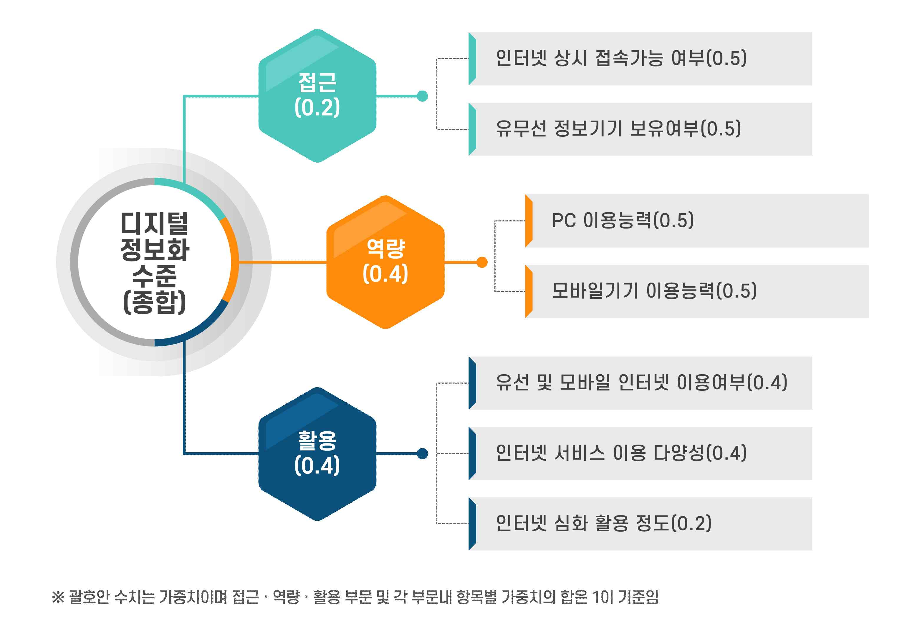
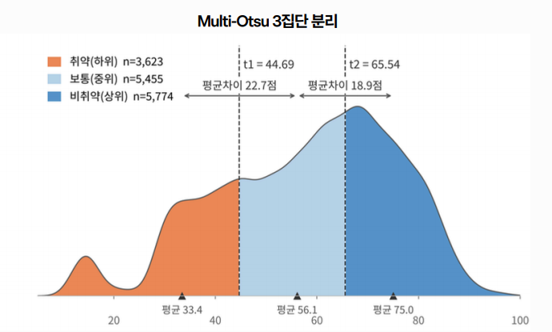
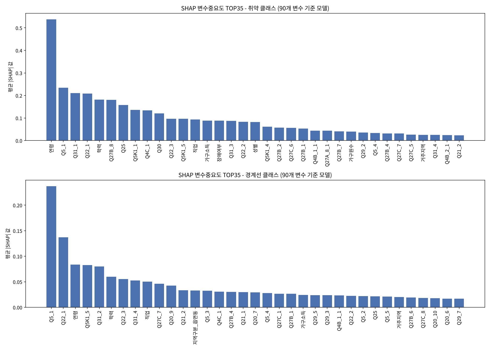
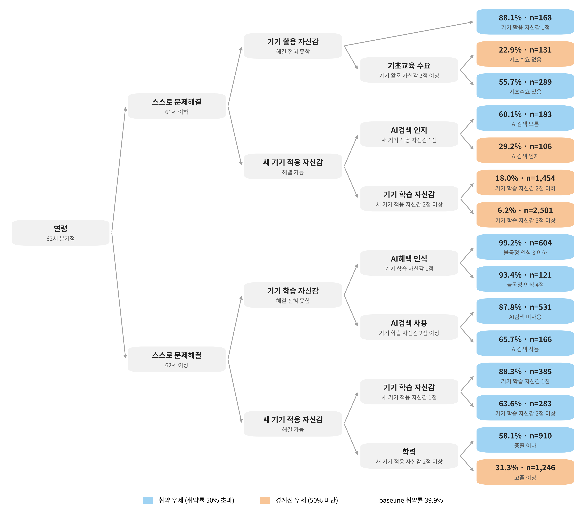

# 디지털 취약계층 재분류: 숨은 취약과 경계선을 가르는 요인 분석

> 장애인·고령층처럼 **'어느 집단에 속하느냐'로 정하던 디지털 취약계층**을,
> 실제 디지털 역량 데이터로 **취약 / 경계선 / 비취약 3집단으로 다시 나누고**, 취약과 경계선을 가르는 요인을 분석

- **프로젝트**: 아이티윌 빅데이터 분석 55기 부트캠프 세미 프로젝트 (3명) | 2026.06 ~ 2026.07
- **담당 역할**: 조장
  - 주제 선정 및 분석 데이터(2025 디지털정보격차 실태조사) 발굴
  - 타겟 변수 설계: 한국지능정보사회진흥원 보고서의 종합지수 산출 방법 조사·적용
  - **인사이트 분석 주도**: SHAP · 의사결정나무 설계 후, 취약과 경계선을 가르는 요인 분석
- **발표 자료**: [docs/발표자료.pdf](docs/발표자료.pdf)

**사용 기술**

`Python` `pandas` `scikit-learn` `LightGBM` `XGBoost` `Random Forest` `SHAP` `Decision Tree` `Multi-Otsu`

**폴더 구조**
```
├─ README.md
├─ requirements.txt
├─ 01_preprocessing.py ~ 05_decision_tree.py
├─ docs/발표자료.pdf
└─ images/             README 그림 첨부용
```

<br>

## 1. 프로젝트 개요

**문제 정의**
- 지금은 장애인, 농어민, 저소득층, 고령층 등 **소속 집단**을 기준으로 디지털 취약계층 지원 대상을 정함
- 같은 집단 안에서도 디지털 역량 차이가 크고, 집단에 속하지 않은 **숨은 취약층**은 놓칠 수 있음

**목표**
1. 디지털 역량 데이터로 '디지털 취약지수'를 만들어 취약 / 경계선 / 비취약 3집단으로 재분류
2. 취약과 경계선을 가르는 요인을 찾아, 취약층으로 떨어지기 전 예방할 수 있는 정책 아이디어 도출

<br>

## 2. 데이터

한국지능정보사회진흥원, [「2025 디지털정보격차 실태조사 통계자료」](https://www.data.go.kr/data/15038422/fileData.do) (공공데이터포털)

- 일반국민, 농어민, 장애인, 저소득층, 북한이탈주민, 결혼이민자 응답 **15,000명**
- 일반국민 중 장애가 있는 응답자는 장애인 계층과 겹쳐서 제외 → **14,852명**
- 2026년 6월 수정 버전으로 분석 (최신 버전으로 실행하면 결과 수치가 조금 다를 수 있음)

<br>

## 3. 분석 흐름

| 단계 | 파일 | 내용 |
|---|---|---|
| 전처리 | `01_preprocessing.py` | 계층별 파일 6개 합치기, 문항 이름 통일, 이진화·결측 처리, X/Y 변수 분리 |
| 타겟 | `02_target_index.py` | 디지털 취약지수 계산 → Multi-Otsu로 3집단 분리 |
| 모델링 | `03_modeling.py` | Random Forest · XGBoost · LightGBM 비교 → LightGBM 최종 선택 |
| 해석 | `04_shap.py` | SHAP으로 취약 / 경계선 판단에 영향이 큰 변수 확인 |
| 해석 | `05_decision_tree.py` | 취약 vs 경계선을 가르는 조건을 의사결정나무 규칙으로 확인 |

<br>

## 4. 타겟 변수: 디지털 취약지수



*출처: 한국지능정보사회진흥원, 「2025 디지털정보격차 실태조사 보고서」*

- 보고서의 디지털정보화 수준(종합) 산출 방법을 그대로 적용해 0~100점 지수로 계산 (낮을수록 취약)
  - 종합지수 = 접근 × 0.2 + 역량 × 0.4 + 활용 × 0.4
- **Multi-Otsu**로 점수 분포를 3구간으로 나눔 (집단 안은 비슷하게, 집단끼리는 최대한 다르게)



| 집단 | 점수 구간 | 인원 |
|---|---|---|
| 취약 | 44.69점 이하 | 3,623명 (24.4%) |
| 경계선 (그림의 '보통') | 44.69 ~ 65.54점 | 5,455명 (36.7%) |
| 비취약 | 65.54점 초과 | 5,774명 (38.9%) |

- 확률로 나누는 Gaussian Mixture보다 "몇 점 이하면 취약"처럼 기준 점수를 명확하게 제시할 수 있어서 선택

<br>

## 5. 결과

### 5-1. 모델 성능

| 평가 지표 | 의미 | LightGBM (최종) |
|---|---|---|
| Macro F1 | 세 집단을 골고루 잘 맞히는지 | 0.7883 |
| 취약 Recall | 실제 취약층 중 찾아낸 비율 | **0.8579** |
| Train-Test 차이 | 과적합 정도 | **0.0317** |

- Random Forest · XGBoost · LightGBM을 GridSearchCV로 튜닝해 비교
- 세 모델의 Macro F1은 비슷했지만, LightGBM은 규제를 강하게 걸어 **과적합을 0.20 → 0.03으로 줄이고 취약층 탐지율은 가장 높게** 유지 → 최종 모델로 선정
- 5-fold 교차검증 Macro F1: train 0.8220 / test 0.7753

### 5-2. SHAP 해석



- 위: 취약 클래스 / 아래: 경계선 클래스, 변수별 평균 |SHAP| 값 TOP 35
- 취약 판단에는 **연령**이 가장 크게 작용하고, 그다음 **스스로 문제해결(Q5_1) · 기초교육 수요(Q31_1) · 기기 학습 자신감(Q22_1) · 학력** 순
- 경계선 판단에는 **스스로 문제해결(Q5_1)**과 **디지털 효능감(Q22_1)**이 연령보다 앞섬
- 디지털 취약성은 인구통계뿐 아니라 **개인의 문제해결 방식과 디지털 자신감**의 영향을 크게 받음

### 5-3. 의사결정나무: 취약 vs 경계선을 가르는 조건



- 취약 · 경계선 두 집단(9,078명)만 대상, 깊이 4 / 한 그룹 최소 100명
- Accuracy 0.803 · Macro F1 0.795 · AUC 0.864 · Train-Test 차이 0.004
- **1차 분기는 연령 62세**, 그 아래에서 **스스로 문제해결(Q5_1)**과 **디지털 효능감(Q22)**이 반복해서 등장
- 파란 칸 = 취약 우세(취약률 50% 초과), 주황 칸 = 경계선 우세(50% 미만)

<br>

## 6. 인사이트

**1. 연령은 출발점일 뿐, 결과는 자립성과 효능감이 결정**
- 같은 61세 이하에서도 취약률이 6.2% ~ 88.1%, 62세 이상에서도 31.3% ~ 99.2%까지 벌어짐
- 그 차이를 만드는 건 스스로 문제를 해결하는지, 디지털 기기에 자신감이 있는지

**2. 취약은 기초를, 경계선은 다음 단계를 원함**
- 취약층은 정보화교육을 알고 있는 비율이 낮아 교육 기회와 연결되지 못했을 가능성
- 경계선은 생활 응용 중심의 실전 활용 교육 수요가 큼

**3. 잘하냐 못하냐가 아니라 '한 칸'의 문제**
- 분기 기준이 "전혀 못함(1점)" vs "조금이라도 함(2점 이상)"
- 큰 역량 목표보다 **작은 성공 경험 하나를 만들어주는 입문 교육**이 필요

**4. AI검색 인지 여부가 디지털 적응력의 신호**
- 자신감이 낮은 같은 집단 안에서도 AI검색을 알면 취약 비율이 60% → 29%로 낮아짐

> 디지털 포용 정책은 '누가 취약집단인가'보다 '누가 실제로 디지털 환경에서 어려움을 겪고 있는가'를 기준으로 설계되어야 한다.

**한계점**
- 직업, 학력, 소득 등은 임의로 채우면 응답자 특성이 왜곡될 수 있어 결측을 그대로 유지 → 결측을 받지 못하는 모델(로지스틱 회귀 등)은 적용이 제한됨
- 설문 데이터라 응답자의 주관적 인식이 반영될 수 있음
- 지역 환경, 교육 경험, 심리적 요인 등 설문 밖 변수는 반영하지 못함

<br>

## 7. 실행 과정

**1) 패키지 설치**
```
pip install -r requirements.txt
```

**2) 데이터 준비**: [공공데이터포털](https://www.data.go.kr/data/15038422/fileData.do)에서 받아서 `data/` 폴더에 저장
```
data/
├─ 2025년 디지털정보격차 실태조사_1) 일반국민_DATA.xlsx
├─ 2025년 디지털정보격차 실태조사_2) 농어민_DATA.xlsx
├─ 2025년 디지털정보격차 실태조사_3) 장애인_DATA.xlsx
├─ 2025년 디지털정보격차 실태조사_4) 저소득층_DATA.xlsx
├─ 2025년 디지털정보격차 실태조사_5) 북한이탈주민_DATA.xlsx
└─ 2025년 디지털정보격차 실태조사_6) 결혼이민자_DATA.xlsx
```

**3) 순서대로 실행**
```
python 01_preprocessing.py
python 02_target_index.py
python 03_modeling.py
python 04_shap.py
python 05_decision_tree.py
```

<br>

## 8. 참고 자료

- 한국지능정보사회진흥원, [디지털정보격차 실태조사 통계자료](https://www.data.go.kr/data/15038422/fileData.do) — 분석 데이터
- 한국지능정보사회진흥원, 「2025 디지털정보격차 실태조사 보고서」 — 종합지수 산출 방법
